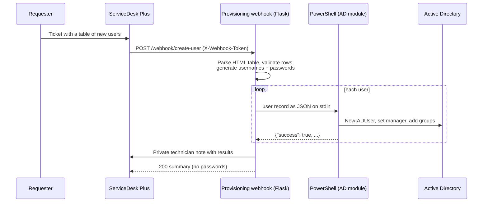

# ITSM → Active Directory Provisioning

[](https://github.com/Yohannesmoke/itsm-ad-provisioning/actions/workflows/ci.yml)

A webhook service that turns a **"new user" ticket in ManageEngine ServiceDesk Plus** into **Active Directory accounts**, then writes the result back to the ticket.

The service desk no longer has to copy names out of a ticket, type them into *AD Users and Computers*, invent passwords and reply to the ticket. That work now takes a few seconds and needs no one to do it.



## Features

- **Parses rich-text tables** from the ticket description, including editor quirks such as nested tables inside cells, `mailto:` links and `&nbsp;`. Header names are matched flexibly, so "First Name", "FirstName" and "GivenName" all work.
- **Validates every row.** Rows with missing required fields and duplicate usernames are skipped and reported, and the rest of the batch still goes through.
- **Generates** `firstname.lastname` usernames (truncated to the 20-character `sAMAccountName` limit) and random passwords that meet the AD complexity rules.
- **Sets the manager and groups.** The manager is looked up by SAM account name, display name or name; group membership is added, and groups that don't exist are reported.
- **Writes back to the ticket** as a technician-only note, so the requester never sees the temporary passwords.
- **Pluggable back ends:** `powershell` for real AD, and `dry-run` for demos, local development and CI.

## Security design

| Concern | How it's handled |
|---|---|
| Webhook spoofing | Shared-secret header compared with `hmac.compare_digest` (constant time) |
| Command injection | The user record is sent to PowerShell as **JSON on stdin**, never built into a command string |
| AD filter injection | Every value placed in a `-Filter` is escaped (`'` → `''`) |
| Password exposure | Passwords are never logged, never returned in the HTTP response, and never put on a process command line |
| Least privilege | The container runs as a non-root user; the PowerShell host account only needs delegated *create user* rights on the target OUs |

## Quick start

```bash
cp .env.example .env            # set WEBHOOK_TOKEN
docker build -t itsm-ad-provisioning .
docker run --rm -p 8000:8000 --env-file .env itsm-ad-provisioning

curl -X POST localhost:8000/webhook/create-user \
  -H 'Content-Type: application/json' -H 'X-Webhook-Token: change-me' \
  --data @examples/sample_ticket.json
```

```json
{"ticket_id": "10423", "total": 3, "succeeded": 2, "failed": 1,
 "results": [
   {"username": "abebe.kebede", "success": true,  "message": "User would be created (dry run)"},
   {"username": "sara.tesfaye", "success": true,  "message": "User would be created (dry run)"},
   {"username": "Missing",      "success": false, "message": "Missing required fields: LastName, OU"}]}
```

### Running against real Active Directory

Run the service on a domain-joined Windows server that has RSAT (the `ActiveDirectory` PowerShell module) installed:

```powershell
pip install -r requirements.txt
$env:PROVISIONER = "powershell"
$env:WEBHOOK_TOKEN = "<long random secret>"
$env:SDP_BASE_URL = "https://servicedesk.example.com"
$env:SDP_API_KEY  = "<technician API key>"
waitress-serve --port 8000 wsgi:app   # or run it as a Windows service
```

In ServiceDesk Plus, add a **Custom Trigger → Webhook** for new requests of the "New user" template. Point it at `/webhook/create-user`, send `request_id` and `description` in the body, and put the token in the `X-Webhook-Token` header.

## Configuration

| Variable | Default | Purpose |
|---|---|---|
| `WEBHOOK_TOKEN` | *(required)* | Shared secret expected in `X-Webhook-Token` |
| `PROVISIONER` | `dry-run` | `dry-run` or `powershell` |
| `SDP_BASE_URL` / `SDP_API_KEY` | unset | Turn on ticket write-back |
| `SDP_VERIFY_TLS` | `true` | Set to `false` only for an internal CA you can't trust any other way |
| `LOG_LEVEL` | `INFO` | Python log level |

## Development

```bash
python -m venv .venv && . .venv/bin/activate
pip install -r requirements-dev.txt
pytest -q          # 19 tests: parser edge cases, auth, write-back failures, PowerShell I/O
ruff check . && ruff format --check .
```

CI runs lint and the tests, builds the Docker image, and smoke-tests the running container against the sample ticket.

## Project layout

```
app/
  __init__.py       Flask app factory and webhook endpoint
  parser.py         ticket HTML → UserRequest records
  provisioner.py    dry-run and PowerShell back ends
  itsm_client.py    ServiceDesk Plus note write-back
scripts/
  New-ADUserFromJson.ps1   reads one user as JSON on stdin and creates it in AD
examples/sample_ticket.json
tests/
```

## License

MIT
